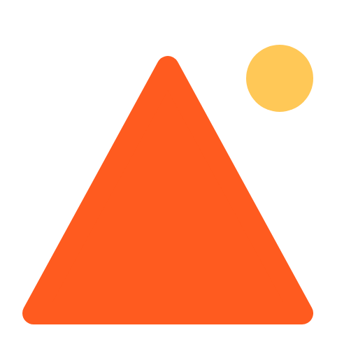

# ultrastable/.github

<!-- identity:start (generated by scripts/surfaces.py from ultrastable.json; do not edit) -->
**Ultrastable organization profile.** The organization's public profile page and community health defaults.
<!-- identity:end -->

> **License: free for non-commercial use; commercial use requires a license and shares revenue with the Licensor.** See [LICENSE](LICENSE) (Ultrastable License v1.0, USL-1.0, source-available, not open source) and [COMMERCIAL-TERMS.md](COMMERCIAL-TERMS.md).

Organization-wide defaults for [Ultrastable](https://github.com/ultrastable): community health files (contributing, conduct, security, support) and the public profile shown at [github.com/ultrastable](https://github.com/ultrastable).

Coding agents write code. Ultrastable runs the system. Web: [ultrastable.io](https://ultrastable.io)

<!-- how:start (generated by scripts/surfaces.py from ultrastable.json; do not edit) -->
## How this system runs

**What it is.** The organization's public profile page and community health defaults.

**The loop it closes.** GitHub reads these community health defaults for every repository of the organization, and the profile page is regenerated from the registries so it lists every system with its live address and repository.
<!-- how:end -->
