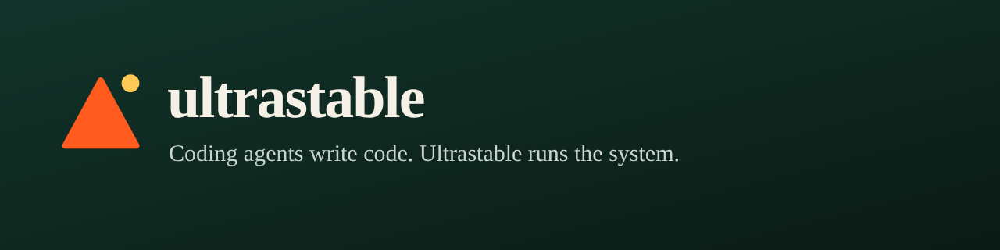

# Ultrastable is the foundation for any autonomous system.

<!-- live:start (generated by python3 -m foundation livelinks from the platform's registries; do not edit) -->
## Where everything runs

| System | Live | Repository |
|---|---|---|
| ultrastable | [https://ultrastable.io](https://ultrastable.io/) | [ultrastable/ultrastable](https://github.com/ultrastable/ultrastable) |
| second-tenant | [https://ultrastable-seed-second-tenant.ultrastable.workers.dev](https://ultrastable-seed-second-tenant.ultrastable.workers.dev/) | [ultrastable/second-tenant](https://github.com/ultrastable/second-tenant) |
| practical-solutions | [https://ultrastable.org](https://ultrastable.org/) | [ultrastable/practical-solutions](https://github.com/ultrastable/practical-solutions) |
| unlearn | [https://unlearn.ultrastable.org](https://unlearn.ultrastable.org/) | [ultrastable/unlearn](https://github.com/ultrastable/unlearn) |
| what-works | [https://what-works.ultrastable.org](https://what-works.ultrastable.org/) | [ultrastable/what-works](https://github.com/ultrastable/what-works) |
| replication-ledger | [https://replication-ledger.ultrastable.org](https://replication-ledger.ultrastable.org/) | [ultrastable/replication-ledger](https://github.com/ultrastable/replication-ledger) |

The same list, read live: [https://ultrastable.io/directory](https://ultrastable.io/directory). Each system's health is at `/health` and what it states, with the endpoint behind each statement, at `/claims.json`.
<!-- live:end -->

A system is autonomous when it has self-referential loops and the ability to close them. Coding agents stop after the first version; Ultrastable does the development work after it. An organization of virtual managers (portfolio, product, project, design, operations) reads the measurements, decides what to improve, files the work, hands it to coding agents, proves the result live and keeps score. You supply the idea and a budget. The system supplies the backlog.

**Ultrastable runs on Ultrastable.** Its own roadmap, issues, managers, trust ledger and deploys are run by the same code it gives everyone else.

## How it works
- **Closed loops**: predict, execute, verify independently, score. Nothing leaves the queue without a recorded disposition.
- **Plussing**: a protected share of capacity goes to improvement, so work does not decay into bug fixes.
- **Earned-trust autonomy**: autonomy widens only from verified results; it pauses only for steps that are both irreversible and identity-bound.
- **Ashby's ultrastable system**: essential variables with limits, and a second loop that changes the first when a variable leaves its bounds.
- **Words match code**: every public statement is backed by a probe or generated from code.

## Repositories
| Repository | What it holds |
|---|---|
| [ultrastable](https://github.com/ultrastable/ultrastable) | The platform: tick Worker, foundation loops, ultrastable.io, dashboard, doctrine, specifications, license and the seed every new system starts from. Start here. |
| [practical-solutions](https://github.com/ultrastable/practical-solutions) | The first system built on Ultrastable: an autonomous bright-spot finder. |
| [workers](https://github.com/ultrastable/workers), [spec](https://github.com/ultrastable/spec), [license](https://github.com/ultrastable/license) | Retired and archived; their contents now live in `ultrastable`. Kept so old links resolve. |

## See it live
[Live loops](https://ultrastable.io/live) · [Verification](https://ultrastable.io/verification) · [A year with no one](https://ultrastable.io/year/failures) · [Trends](https://ultrastable.io/trends) · [Research](https://ultrastable.io/research) · [Claims](https://ultrastable.io/claims)

## License
Source-available under the Ultrastable License v1.0: free for non-commercial use, commercial use needs a license. Not open source; no patent claims. Pilots and commercial licensing: pilot@ultrastable.io
