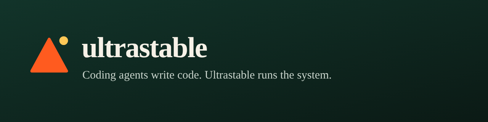

# Coding agents write code. Ultrastable runs the system.

Ultrastable is an autonomous system that takes one idea and bootstraps what a new venture needs: development, branding, a provisional-patent filing package, a business plan, search and analytics presence, and marketing. Then it keeps improving itself.

It manages itself, and you steer when you want to, so you do not need a development team, a patent lawyer or a marketing firm to get going. Anything you can describe is something it can start on.

## Where to find us
- Web: [ultrastable.io](https://ultrastable.io) (also ultrastable.app and ultrastable.net)
- Proving ground: [QNFO](https://github.com/QNFO) is the first test case showing the system works in practice.
- Our core platform repository is private for now. Pilots and partnerships: pilot@ultrastable.io

## Status
Early and in active development, working with a small number of design partners. Legal and patent outputs are drafts for professional review, not legal advice. Financial back-end is not part of what we do. Technical detail is intentionally not public yet.
